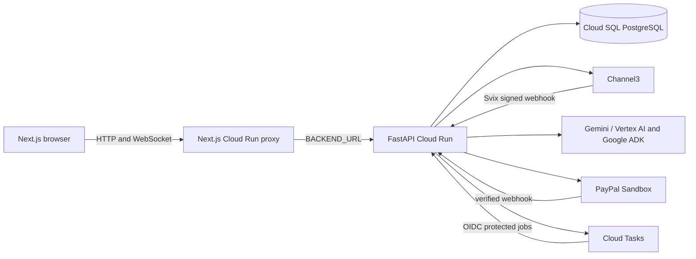

# ShopSide AI

### A little closer, even from afar.

**Two people shop together, AI agents help them reach a better decision, and PayPal completes the approved purchase.**

Shopping with someone far away usually means scattered links, repeated questions, and decisions lost in chat. Sellers see the other side: a ready buyer who leaves because the price does not work.

ShopSide connects those moments. Up to four people discover, compare, discuss and choose in a shared shopping room. When a shopper opts into **Deal Rescue**, a buyer agent checks their limits and a merchant agent works within the seller’s policies. People retain control over seller approval and PayPal payment approval.

> **Demonstrated Sandbox outcome:** a $290 desk-and-chair basket became a seller-approved $250 offer. The buyer approved payment, ShopSide verified the capture, and the room received an order receipt recording the $40 saving.

This is a working hackathon application, with real Channel3 discovery, Gemini and Google ADK agents, collaborative rooms, and PayPal Sandbox payments. The merchant test catalog is fictional: no real money is charged and no goods ship.

## The experience

| Moment | What ShopSide does |
| --- | --- |
| **Describe a goal** | Extracts the shopping request, budget, preferences and constraints through one entry point. Furniture, fashion and electronics share the same workspace. |
| **Bring your people** | Invite by link, join by name, and share messages, saved products, reactions and decisions across browser sessions. |
| **Compare the evidence** | Channel3 discovery and the AG Grid Decision Board put observed prices, retailers, available attributes, evidence and participant reactions side by side. Missing specifications remain unknown. |
| **Build a complete choice** | Smart Bundle gathers candidates with ADK tools and validates categories, currency, prices and budget on the backend. Choose, swap, approve and save a bundle together. |
| **Understand the options** | Variant Studio, Seller Lens, Swap & Save, Style Lock and Price Intelligence extend the same product journey, using provider data where available. |
| **Preview a room, optionally** | Eligible furniture can open Move-in Studio on demand. Normal shopping does not require WebGL or load the 3D experience automatically. |
| **Rescue a stalled deal** | An opted-in merchant receives consented demand. Its agent proposes an offer within configured rules; required seller review happens before publication. |
| **Approve and pay** | The buyer agent checks offer acceptance rules. The buyer separately approves PayPal payment. Verified capture unlocks the receipt and decision timeline. |

## Deal Rescue: two agents, clear authority

```mermaid
flowchart LR
  Buyer[Buyer sets limits and opts in] --> Match[Match participating merchants]
  Match --> Merchant[Merchant agent proposes an offer]
  Merchant --> Seller[Seller reviews when required]
  Seller --> Quote[Offer arrives in the shared room]
  Quote --> Agent[Buyer agent validates acceptance rules]
  Agent --> Pay[Buyer approves PayPal payment]
  Pay --> Verify[Verify provider capture]
  Verify --> Receipt[Order receipt and decision timeline]
```



**Buyer agent:** checks the offer against the shopper’s consent, amount limit and applicable policy. Accepting a quote does not grant permission to charge the buyer.

**Merchant agent:** uses consented demand, eligible merchant products and approved pricing policies. It does not represent unaffiliated Channel3 retailers or receive the room’s private chat.

**PayPal:** supplies the payment approval and settlement boundary. Ordinary checkout uses CAPTURE. The implemented bounded AUTHORIZE workflow lets a buyer approve a capped hold for an explicitly mapped merchant before the seller responds. Settlement revalidates merchant, SKU, quantity, stock, buyer policy, currency, amount and expiry. Lower-amount capture remains individually gated; without verified capability, ShopSide voids the hold and requests a fresh buyer-approved checkout.

The illustrated demo demonstrates negotiated **buyer-approved capture**. It should not be described as proof of offline authorization settlement.

## Two catalogs. Two honest checkout paths.

| Source | What is real | Where payment happens |
| --- | --- | --- |
| **CHANNEL3_LIVE** | Provider product records, observed retailer offers and available attributes | At the external retailer, using a refreshed retailer link. ShopSide does not own that inventory or collect its payment. |
| **SHOPSIDE_SANDBOX** | Working merchant policies, negotiation, inventory checks, orders and Sandbox payment integration; fictional products | PayPal Sandbox through ShopSide, with buyer approval and verified capture. |

A Channel3 price alert can prompt a search for a ShopSide-owned alternative. That alternative may be a different product; it never authorizes payment for the external listing.

## What has actually been demonstrated?

Implementation, application observations and independent provider reconciliation are different levels of evidence.

| Capability | Evidence and status |
| --- | --- |
| Fresh two-person journey | Recorded independent Alex and Jamie browser contexts, two-way chat, reactions, comparison, Smart Bundle selection and shared approval. |
| Merchant negotiation | Recorded a fresh merchant opportunity, seller approval, offer arrival and buyer-agent acceptance within the configured limit. |
| PayPal Sandbox capture | Completed through interactive buyer approval in the recorded application. Receipt reports order `8KU948533N759762K`, capture `4G178691U30729931`, $250 captured and $40 saved. This observation is not an independent PayPal dashboard audit. |
| Capped AUTHORIZE workflow | Implemented, including strict scope checks and guarded settlement. The latest recorded CAPTURE journey does not establish end-to-end offline settlement. |
| PayPal webhook delivery | Operator supplied PayPal dashboard events marked Success for an earlier order. Signature verification and reconciliation are implemented. Those events have not been independently correlated here with the deployed SQL event/job records. |
| Channel3 Price Watch | Signed webhook handling, durable events, subscription preferences and alerts are implemented. Live signed delivery is deployment-specific and is not established by the payment recording. |
| UI checks | Latest UI change passed six browser checks covering responsive bundles, sampled text/action contrast, merchant navigation/retry and order summary; the frontend production build passed. This is targeted coverage, not a claim that every live provider combination was exercised. |

Payment completion is based on verified provider capture, not merely order creation, buyer quote acceptance or a webhook delivery status. Provider identifiers above are test references, not credentials.

## Evaluate ShopSide in minutes

### Fastest path: two real guest identities

1. Open the deployed frontend in two independent browser profiles (or a regular window and a private window). No ShopSide account is required. Use **Alex** in the first and **Jamie** in the second.
2. Alex enters “A compact desk and ergonomic chair under $500” and creates a room. Copy its invitation into Jamie’s browser; Jamie enters a name and joins. A guest identity belongs to that browser session; sharing the room URL does not make both people the same participant.
3. Send a message in each direction. Save two Channel3 products, compare them in the Decision Board and add a reaction from each person. Check that the second browser updates without refreshing.
4. Run Smart Bundle, inspect the total and remaining budget, choose a bundle, approve from both browsers and save it to the shared plan. Retailer listings continue to their own checkout.
5. For Deal Rescue, use an opted-in **ShopSide Sandbox merchant** with available stock, a configured minimum price and an operator-approved pricing policy. Set a buyer offer limit and require seller review. The authenticated merchant operator reviews the opportunity in `/merchant`, proposes an offer and approves publication.
6. Watch the offer arrive in the buyer room. Distinguish acceptance of that quote from payment approval. Review the exact Sandbox order, approve in PayPal using an authorized Sandbox buyer account, then return to the captured order and receipt.

Merchant tokens and Sandbox buyer credentials are supplied privately by the operator through secure settings. They are deliberately absent from the repository. Room collaboration can be evaluated without them; merchant operation and interactive payment require that authenticated access. Sandbox outcomes depend on current inventory and policies, so the $250 example is evidence of a completed run, not a promised price for every run.

### Prepared preview room

```sh
FRONTEND_URL=https://<frontend-cloud-run-url> .venv/bin/python scripts/seed_showcase_room.py
```

The existing seeder creates a persisted room with Person A and Person B, two eligible catalog products, placements, reactions and chat. It prints an invitation for reviewers to join as another guest. Seeded identities are historical participants, not public login accounts or transferable browser sessions. Use the fresh Alex/Jamie path above to reproduce two independent interactive approvals. Each seed run creates a new room; retain its invitation privately and confirm the room is reachable before sharing it with judges.

### Record one uninterrupted payment proof

Keep a supplementary continuous clip of the payment journey, separate from the edited promotional film:

1. Show the accepted merchant quote and exact total.
2. Open PayPal Sandbox and show buyer approval. Authenticate before recording where possible; never expose passwords or personal account details.
3. Return to ShopSide and show verified capture, receipt, PayPal order ID and capture ID.
4. In the authorized PayPal Sandbox dashboard, show the corresponding capture and webhook event. Match the **same** order/capture IDs; older successful events do not prove this purchase’s delivery.
5. Run the read-only PostgreSQL check in [scripts/db/verify_paypal_receipt.sql](scripts/db/verify_paypal_receipt.sql) with that order ID. Confirm the payment is paid, the matching capture is recorded and the corresponding event processing state is `processed`. A delivered event still marked `pending` is not completed reconciliation.

The latest film contains a fresh successful application capture and receipt, but excludes credential entry and is edited. It is not described as uninterrupted PayPal-dashboard-to-database evidence. The corresponding provider event and deployed SQL reconciliation remain to be correlated by an authorized operator; no dashboard or database access is implied by a public room invitation.

## Architecture



The browser uses the frontend origin for API calls. The Next.js server forwards HTTP and WebSocket traffic to the backend URL configured at runtime. Provider credentials stay on the backend. FastAPI persists room state and payment records in PostgreSQL in production; SQLite is for local development. Cloud Tasks dispatch merchant and reconciliation jobs. Current room coordination and locks assume one API instance, so do not scale the backend horizontally until shared coordination is implemented.

## Local development

Prerequisites: Python 3.12, Node.js 24, npm, and optionally SQLite or PostgreSQL.

```bash
python3 -m venv .venv
.venv/bin/pip install -r services/api/requirements.lock
npm ci --prefix services/paypal-mcp
npm ci --prefix apps/web
cp .env.example .env
```

Configure optional local credentials in `.env` and load them into the shell. Treat `.env` as executable shell input; never commit it. Start the API:

```bash
export SHOPSIDE_DB="$PWD/shopside.sqlite3"
bash scripts/db/migrate.sh
PYTHONPATH=services/api .venv/bin/uvicorn app.main:app --host 127.0.0.1 --port 8000 --workers 1
```

In another terminal:

```bash
cd apps/web
BACKEND_URL=http://127.0.0.1:8000 npm run dev
```

Open `http://localhost:3000`, create a room and open its invitation in another browser profile. `bash scripts/dev.sh` is also available for local setup and startup. Without `DATABASE_URL`, the API uses `SHOPSIDE_DB` or `/tmp/shopside.sqlite3`.

Provider credentials are optional for local rooms and fictional catalog browsing. Live Channel3, AI, PayPal, webhook and Cloud Tasks features require their corresponding configuration. The three sandbox merchants start opted out and paused. Supply three distinct merchant tokens securely, then enable each merchant in `/merchant` for tests that need merchant responses.

## Configuration reference

Set secrets through a local secret store or GCP Secret Manager. Do not put secrets in browser variables, committed files, logs, or chat.

| Variable | Service | Purpose |
| --- | --- | --- |
| `BACKEND_URL` | Frontend | Backend HTTP(S) origin, no path or credentials. Set at runtime on Cloud Run. |
| `BACKEND_ID_TOKEN_AUDIENCE` | Frontend | Optional audience for an IAM-protected backend. Grant the frontend runtime identity `roles/run.invoker`. |
| `DATABASE_URL` | API | PostgreSQL connection. Required on Cloud Run; can use the Cloud SQL Unix socket format below. |
| `SHOPSIDE_DB` | API | Local SQLite database path when `DATABASE_URL` is absent. |
| `WEB_ORIGIN` | API | Exact public frontend origin, including scheme. |
| `COOKIE_SECURE` | API | Set `true` when the frontend is served over HTTPS. |
| `CHANNEL3_API_KEY` | API | Server-side Channel3 key. |
| `CHANNEL3_WEBHOOK_SECRET` | API | Svix signing secret from Channel3 webhook settings. |
| `PAYPAL_ENV` | API | Must be `sandbox` for the implemented checkout. |
| `PAYPAL_CLIENT_ID`, `PAYPAL_CLIENT_SECRET`, `PAYPAL_MERCHANT_ID` | API | PayPal Sandbox credentials and the payee used by standard checkout. |
| `PAYPAL_WEBHOOK_ID` | API | PayPal Sandbox webhook ID used to verify webhook signatures. |
| `PAYPAL_MERCHANT_IDS_JSON` | API | Optional JSON map from ShopSide merchant IDs to verified PayPal Sandbox payee IDs. Enables AUTHORIZE for mapped merchants. |
| `PAYPAL_PARTIAL_CAPTURE_MERCHANT_IDS_JSON` | API | Optional JSON array of merchant IDs whose lower-amount capture capability has been verified. Keep unset otherwise. |
| `AI_PROVIDER` | API | `vertex-express`, `vertex`, or `developer`. |
| `VERTEX_API_KEY` or `GEMINI_API_KEY` | API | Vertex AI express key, or Gemini Developer API key when selected. |
| `GEMINI_MODEL` | API | Model ID available to the selected provider. |
| `GOOGLE_CLOUD_PROJECT`, `GOOGLE_CLOUD_LOCATION` | API | Project and location for standard Vertex AI and Cloud Tasks. |
| `SHOPSIDE_MERCHANT_1_TOKEN` through `_3_TOKEN` | API | Distinct merchant portal tokens, at least 24 characters. Store as secrets. |
| `SHOPSIDE_MERCHANT_1_DOMAIN` through `_3_DOMAIN` | API | Optional merchant research labels; not proof of Channel3 inventory ownership. |
| `CLOUD_TASKS_LOCATION`, `CLOUD_TASKS_QUEUE`, `CLOUD_TASKS_TARGET_URL`, `CLOUD_TASKS_INVOKER_SERVICE_ACCOUNT` | API | Cloud Tasks queue, backend target and OIDC invoker. Set with `GOOGLE_CLOUD_PROJECT`; omit all for local fallback. |
| `CLOUD_TASKS_OIDC_AUDIENCE` | API | Optional audience override; defaults to the backend target URL. |
| `MERCHANT_JOB_TOKEN` | API | Local-only protected merchant-job recovery token. |

Cloud SQL Unix socket example:

```text
postgresql+psycopg://DB_USER:URL_ENCODED_PASSWORD@/DB_NAME?host=/cloudsql/PROJECT_ID:REGION:INSTANCE_ID
```

`PAYPAL_MERCHANT_IDS_JSON` and `PAYPAL_PARTIAL_CAPTURE_MERCHANT_IDS_JSON` are JSON configuration values, not PayPal secrets. Map only merchant accounts you have verified. A temporary authorization is not a long-term payment mandate. Vaulting and future off-session mandates are not implemented.

## Database migrations

Alembic revisions are in `services/api/alembic/versions`. Apply migrations once before starting the new revision:

```bash
bash scripts/db/migrate.sh
bash scripts/db/migrate.sh current
```

Revision `0005` adds durable Channel3 webhook events and watches, PayPal webhook payloads, and settlement jobs. Run migrations as a controlled deployment job, not concurrently from every application instance. The API retains startup table creation for its baseline tables.

The SQLite-to-PostgreSQL importer is `scripts/db/import_sqlite_to_postgres.py`. Use it only with a backup and an empty, migrated PostgreSQL destination; stop application traffic during import and verify the data before switching. It does not modify the SQLite source.

## GCP Cloud Run deployment

Use separate Cloud Run services for the frontend and API. Deploy the API first, apply the migration job, then deploy the frontend with `BACKEND_URL` set to the API origin. Keep the backend IAM protected when possible; Cloud Tasks uses OIDC identity to call protected worker endpoints.

1. Enable Cloud Run, Cloud SQL, Cloud Tasks and Secret Manager APIs. Create Cloud SQL PostgreSQL 17.11 and attach it to the backend service. Grant the backend runtime identity `roles/cloudsql.client` and access only to the secrets it needs.
2. Build and deploy the API from `services/api/Dockerfile` using the `services/` directory as build context. Set `DATABASE_URL`, `WEB_ORIGIN`, `COOKIE_SECURE=true`, provider settings, and the correct region/project variables.
3. Run `alembic -c /app/alembic.ini upgrade head` once in a Cloud Run Job using the API image, database attachment and runtime identity. Verify the job succeeds before routing traffic.
4. Create a Cloud Tasks queue and a dedicated task invoker service account. Grant the task account `roles/run.invoker` on the backend. Grant the backend producer identity permission to create tasks and `iam.serviceAccountUser` on the invoker identity. Set all Cloud Tasks variables on the backend.
5. Register the publicly reachable `/api/channel3/webhooks` endpoint in Channel3 (use the frontend proxy origin when the backend requires IAM) and store the supplied Svix secret as `CHANNEL3_WEBHOOK_SECRET`. Register the publicly reachable `/api/paypal/webhook` endpoint in the PayPal Sandbox app (the frontend proxy can forward to an IAM-protected backend) and set `PAYPAL_WEBHOOK_ID`.
6. Deploy the frontend from `apps/web/Dockerfile`. Set `BACKEND_URL` at runtime to the backend origin. If the backend requires IAM, set `BACKEND_ID_TOKEN_AUDIENCE` to that service URL and grant the frontend identity `roles/run.invoker`.
7. Keep the API at one instance for this release. Current locking, room coordination and some job claims are process-local. Cloud SQL persistence does not make multiple API instances safe.
8. Configure Cloud Scheduler with OIDC to call `POST /api/internal/paypal-settlements/recover` for pending settlement jobs and `POST /api/internal/paypal-authorizations/expire` to void expired or revoked authorizations. The token email must match `CLOUD_TASKS_INVOKER_SERVICE_ACCOUNT`, because the backend verifies that exact identity; grant the Cloud Scheduler service agent permission to mint its OIDC token. Configure an appropriate timeout for WebSockets; browsers reconnect and reload the latest room state after disconnection.

Do not make a private backend public only to admit tasks. Match the task URL and audience to the deployed backend URL, and verify the task invoker identity. Cloud Run and Cloud Tasks IAM, Cloud SQL connectivity, provider webhook delivery, and each newly deployed payment configuration must be checked in the target GCP project. The recorded Sandbox capture above establishes one successful application journey, not every configuration or settlement mode.

## Verification

Run locally:

```bash
PYTHONPATH=services/api .venv/bin/python -m pytest -q services/api/tests
npm run build --prefix apps/web
```

Browser tests are in `apps/web/tests` and run with Playwright against a locally running app. Use only disposable databases for tests; tests create rooms, payments and fictional inventory. The live discovery script `scripts/verify_live_discovery.py` calls Vertex AI and Channel3 and may consume quota. Review its behavior before running it with live credentials.

Automated tests do not prove a deployed Cloud Tasks delivery or interactive PayPal buyer authorization and capture. A PayPal order in `CREATED` status is not a completed payment. ShopSide marks payment complete only after provider readback verifies the capture.

## Release scope and operational boundaries

- Channel3 Price Watch subscriptions are limited to en-US/USD. Webhook alerts reflect when Channel3 detects an offer change, not an instant retailer update.
- PayPal is Sandbox only. Interactive buyer-approved CAPTURE was demonstrated in the fresh recorded journey above. The bounded AUTHORIZE workflow is implemented; end-to-end offline settlement and deployed webhook-to-SQL/job reconciliation remain separate verification items. Lower-amount capture stays disabled unless explicitly mapped as verified.
- No Channel3 programmatic checkout is enabled. External listings are purchased at their retailers, and ShopSide does not collect PayPal funds for them.
- No PayPal vaulting, long-lived payment mandate, or production off-session charging is implemented.
- Cloud Run multi-instance room coordination is not ready. Keep one backend instance until room locks, rate limits, payment claims and subscription lifecycle coordination use shared distributed primitives.
- Shipping and tax are zero for fictional ShopSide sandbox items. The app does not calculate delivered totals. Real retailer prices and stock can change.
- The 3D room uses illustrative markers, not product models or verified fit measurements. Smart Bundle compatibility and AI match scores are recommendations, not factual guarantees.
- Channel3 affiliate reporting depends on API-key entitlement and provider attribution data.

## Repository map

```text
apps/web/                         Next.js app, runtime proxy, browser tests
services/api/app/                 FastAPI room, discovery, agent, merchant and payment code
services/api/alembic/versions/    Versioned database migrations
services/api/tests/               Backend regression tests
services/paypal-mcp/              Pinned PayPal MCP dependency
scripts/db/                       Migration and SQLite import helpers
scripts/dev.sh                    Local development startup
scripts/verify_live_discovery.py  Opt-in live Vertex AI and Channel3 check
```

See [LICENSE](LICENSE) for the project license.
