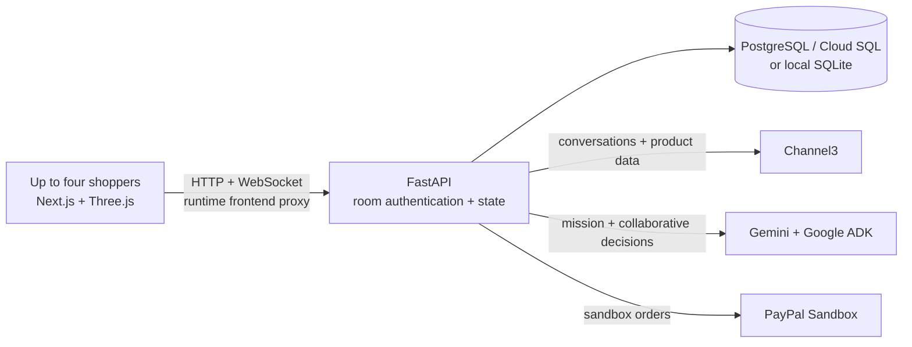

<div align="center">

# ShopSide

### Move in together, even when you're apart.

**A shared shopping space for life's next chapter.**

Plan a home, discover real products, and make the decision together.

`Next.js` · `FastAPI` · `Google ADK + Gemini` · `Channel3` · `Three.js` · `PayPal Sandbox` · `PostgreSQL`

[Get started](#get-started) · [How it works](#how-it-works) · [Configuration](#configuration) · [Cloud Run](#deploying-to-cloud-run) · [Testing](#testing)

</div>


## The idea

Setting up a new home involves more than finding a product. Families and friends have different priorities, a limited budget and a long list of decisions. ShopSide gives them one room to explore options, talk through tradeoffs and agree on what comes next.

Shoppers start with one shared goal in a room for up to four people. Gemini interprets the request into a structured goal and enables the existing Move-In plan when it detects a move or home-furnishing context. Members join with a private invitation, see updates live and can reconnect to their saved state. A shared choice requires approval by every current member. No account is required for the guest flow.

| Experience | What it does |
| --- | --- |
| **Move-In Studio** | Turn a brief into an editable mission with budget, priorities and constraints; Gemini asks at most four follow-up questions. |
| **Real discovery** | Search Channel3 products, inspect available details and variants, compare retailer offers, and find similar or cheaper options when supported. |
| **Smart Bundle** | ADK tools search Channel3 for two to four requested product types; the server builds budget-aware combinations from observed retailer offers. Room members can select, swap, save and explicitly approve a version. Product compatibility, delivery and current prices must be checked with retailers. |
| **Shared decisions** | Spotlight, shortlist, compare, chat, react and explicitly approve a choice. A reaction is not an approval. |
| **Live 3D room** | Place, move and react to shared product markers in an interactive Three.js room. |
| **Why this pick?** | Review known price and product facts, each person's feedback and details still worth checking. |
| **Checkout** | Visit the retailer for Channel3 products; use payer-approved PayPal Sandbox checkout for fictional ShopSide merchant items. |
| **Shared memory receipt** | An AI-written dual receipt is gated on timestamped approvals and two independently verified sandbox captures. Current checkout supports one payer, so it cannot yet create a dual receipt. |

The interior artwork is AI-generated and illustrative. The 3D room uses generic set dressing and product **markers**, not actual product models or verified dimensions; it cannot prove a product will fit. If WebGL cannot start, a simplified interactive room is shown instead. Fictional ShopSide inventory does not ship goods.

## How it works



- The browser talks to its own frontend origin. The Node server proxies `/api/*` HTTP and WebSocket requests to the runtime `BACKEND_URL`; provider secrets stay on the backend.
- FastAPI stores room membership, mission, products, preferences, marker reactions, decisions and checkout status. Mutations use room membership, revision checks and command IDs; room snapshots are sent over WebSockets.
- **Channel3** is the primary source for real shopping conversations, search and product information. General shopping uses its native Conversations API; responses are buffered, not streamed.
- **Gemini** extracts the structured Move-In mission. The existing **Google ADK** agent helps with shared decisions using room context and tools. It cannot authorize payment or substitute an AI suggestion for human approval.
- **PayPal Orders v2** creates and captures eligible ShopSide sandbox orders. The official PayPal MCP adapter is restricted to reading the authenticated room's bound order; it does not authorize spending.
- External Channel3 offers keep their retailer URLs and are never charged through the ShopSide merchant account.

## Get started

### Prerequisites

- Python 3.12 and Node.js 24 with npm.
- SQLite for local development, or a PostgreSQL database. Cloud SQL PostgreSQL 17.11 is the intended GCP database.
- Provider credentials for the features you want to exercise. Rooms and the fictional catalog can run without live shopping, AI or PayPal credentials; provider-dependent actions report errors until configured.

### Local setup

From the repository root:

```bash
python3 -m venv .venv
.venv/bin/pip install -r services/api/requirements.lock
npm ci --prefix services/paypal-mcp
npm ci --prefix apps/web

# Optional: edit a local copy with your own settings. Never commit secrets.
cp .env.example .env
```

Load the desired variables from `.env` into your shell or set them through your environment manager. Then, in one terminal:

```bash
export SHOPSIDE_DB="$PWD/shopside.sqlite3"
bash scripts/db/migrate.sh
PYTHONPATH=services/api .venv/bin/uvicorn app.main:app --host 127.0.0.1 --port 8000 --workers 1
```

In a second terminal:

```bash
cd apps/web
BACKEND_URL=http://127.0.0.1:8000 npm run dev
```

Open **http://localhost:3000**. Create a room, copy the invite and open it in a separate browser profile with a different name. For a quick local startup, `bash scripts/dev.sh` installs dependencies, loads a local `.env` if present, applies migrations and starts both services. Only use an `.env` file you trust: the script sources it as shell input.

`SHOPSIDE_DB` is the SQLite file path; without it the API uses `/tmp/shopside.sqlite3`. `DATABASE_URL` takes precedence when set. Configure exactly **one API process and one worker** for the current MVP.

### Try the two-person journey

1. Enter: “We're moving next Friday and need a home office and kitchen under $500.” When the goal has been interpreted, open **View plan** to review or edit the mission.
2. Search for real products or choose **Find matches from your plan**. Open a result to inspect details and retailer offers, then add it to the shared plan.
3. Invite a friend. Open **Our room** to place a product marker and react to it; discuss and explicitly approve a plan item together.
4. Open a Channel3 offer at its retailer. For the fictional ShopSide merchant catalog, the designated payer can review a USD quote and approve a PayPal Sandbox order.

The 3D layout, reactions and decisions are shared. Cost shares record an allocation only: they do not charge either person or establish that both accepted the allocation.

To try Smart Bundle, enter “Desk and ergonomic chair under $300”, create the room, then select **Find bundles**. Invite another person, choose a bundle, use **Swap** to change one item, and approve the updated version from each browser. **Save to shared plan** records the selected retailer-offer snapshot. Open the individual retailer links to verify current prices and purchase separately; bundle approval is not payment authorization. Set `SHOPSIDE_BUNDLE_TRACE=true` only in a development environment to expose the Agent activity section with tool names and counts, without model reasoning.

Smart Bundle uses Google ADK tools to search Channel3 and solicit structured Gemini recommendations. The backend checks product/offer IDs, category coverage, distinct products, currency, stock status, retailer attribution and the exact subtotal against the budget; invalid model proposals are discarded and a validated deterministic fallback is used when available. When Best Match and Budget Saver are the same product mix, a different eligible mix is offered as **Another option** if one exists; its label does not claim a higher match score. Model-generated prose is not shown as verified fact. AI match and self-assessment scores are uncalibrated model judgments, not guarantees or purchase probabilities. Evidence is a data-completeness label: each item gets points for verified price/currency and retailer, known stock, available specifications, an observation less than 24 hours old, and delivery information. **High** requires at least 5 of 6 points for every item and known delivery; **Medium** requires at least 3; otherwise it is **Low**. Shipping and taxes still need retailer confirmation.

Each bundle run allows one active run per room, up to six model calls across intent interpretation and bundle generation, ten actual Channel3 HTTP attempts including retries, one refinement for a category with no eligible products, and a 45-second bundle timeout. Intent interpretation has a separate 45-second timeout. Individual Channel3 calls use a 10-second timeout and at most one transient retry. A model request is rejected above 16,000 provider-counted input tokens (with an 80 KB preflight limit); output is capped at 1,024 tokens for intent and 4,096 for bundle generation. Alternative searches consume the remaining model and HTTP allowance from the current run. These limits protect this single-instance MVP; they are not a claim of the model's maximum capacity.

## Configuration

Keep credentials on the server in secure environment settings or GCP Secret Manager. Do not place secrets in source control, browser code or chat. `.env.example` lists local settings; update `SHOPSIDE_DB` for your machine if using SQLite.

| Variable | Service | Purpose |
| --- | --- | --- |
| `BACKEND_URL` | Frontend | API HTTP(S) origin selected at server startup, such as `http://127.0.0.1:8000`; no path or credentials. |
| `BACKEND_ID_TOKEN_AUDIENCE` | Frontend | Optional API service URL for an IAM-protected Cloud Run backend. The frontend service account needs `roles/run.invoker`. |
| `DATABASE_URL` | API | PostgreSQL connection string. Required in Cloud Run; use Secret Manager. |
| `SHOPSIDE_DB` | API | Local SQLite path when `DATABASE_URL` is absent. |
| `WEB_ORIGIN` | API | Exact public frontend origin, including scheme and port when applicable. |
| `COOKIE_SECURE` | API | Set `true` when the public frontend uses HTTPS. |
| `CHANNEL3_API_KEY` | API | Server-side Channel3 API key. |
| `AI_PROVIDER` | API | `vertex-express`, `vertex` or `developer`; for this project use `vertex-express` if using a Vertex AI express key. |
| `VERTEX_API_KEY` or `GEMINI_API_KEY` | API | Vertex AI express key; `GEMINI_API_KEY` also supports the Developer API when that provider is selected. |
| `GEMINI_MODEL` | API | A tool-capable model ID available to the configured account. |
| `GOOGLE_CLOUD_PROJECT`, `GOOGLE_CLOUD_LOCATION` | API | Project and region for standard Vertex AI with Application Default Credentials; express mode does not need the project selector. |
| `PAYPAL_ENV` | API | Use `sandbox`; the implemented payment integration is sandbox-only. |
| `PAYPAL_CLIENT_ID`, `PAYPAL_CLIENT_SECRET`, `PAYPAL_MERCHANT_ID` | API | Credentials and merchant ID for the same PayPal sandbox business account. |


## Database scripts

Alembic migrations are versioned under [`services/api/alembic/versions`](services/api/alembic/versions). They create rooms, payments and inventory; historical migrations also preserve the retired relocation-policy table. Room-level features, including 3D markers and reactions, are stored in room state and do not require an additional migration.

| Command | Purpose |
| --- | --- |
| `bash scripts/db/migrate.sh` | Apply all pending migrations to the configured database. |
| `bash scripts/db/migrate.sh current` | Show the current Alembic revision. |
| `PYTHONPATH=services/api .venv/bin/python scripts/db/import_sqlite_to_postgres.py /path/to/source.sqlite3` | Copy a SQLite database into an **empty, migrated PostgreSQL database** selected by `DATABASE_URL`. |

The migration wrapper prefers `.venv/bin/alembic`, then an `alembic` on `PATH`; set `ALEMBIC_BIN` to use a different executable. The importer reads SQLite in a read-only transaction, copies rooms, members, payments, inventory and any legacy relocation policies, and refuses a nonempty destination. Older SQLite databases without a relocation-policy table are supported. It never deletes or modifies the source.

Before importing, **back up both databases and stop application traffic**. Apply migrations to a new empty PostgreSQL destination, run the importer before starting the API's inventory seeding, and verify the data before switching traffic. Never use a production database as a test target.

## Deploying to Cloud Run

1. Build the frontend using [`apps/web/Dockerfile`](apps/web/Dockerfile), and the API using [`services/api/Dockerfile`](services/api/Dockerfile) with `services/` as its build context. Both honor Cloud Run's `PORT`.
2. Attach Cloud SQL PostgreSQL 17.11 to the API service and give its service account `roles/cloudsql.client`. Inject `DATABASE_URL` from Secret Manager. For a Unix socket, the format is:

   ```text
   postgresql+psycopg://DB_USER:URL_ENCODED_PASSWORD@/DB_NAME?host=/cloudsql/PROJECT_ID:REGION:INSTANCE_ID
   ```

3. Run the migrations once as a controlled Cloud Run Job with the same image, database attachment and identity: `alembic -c /app/alembic.ini upgrade head`. Do not race migrations with app traffic. The API also creates missing baseline tables and seeds fictional inventory at startup for compatibility.
4. Set the frontend `BACKEND_URL` to the API origin. If the API is IAM-protected, set `BACKEND_ID_TOKEN_AUDIENCE` and grant the frontend service account `roles/run.invoker`. Runtime backend selection does not require a frontend rebuild.
5. Set `WEB_ORIGIN` to the exact HTTPS frontend origin and `COOKIE_SECURE=true` on the API. Configure the provider secrets described above.
6. Use **one API instance and one worker**, route to one revision and avoid overlapping revisions while testing. WebSocket clients poll shared database revisions every 1.5 seconds so updates from another instance appear without refreshing. Rate limits, operation locks and merchant job claims remain process-local. Cloud Run can temporarily exceed scaling limits; horizontal scaling needs shared coordination before it is safe. WebSocket timeouts can disconnect users, so use the existing reconnect control.

### Collaboration settings and troubleshooting

- Deploy the **API first**, then the frontend. The new API accepts existing membership cookies while the new frontend assigns a separate HttpOnly membership cookie to each tab. This avoids one browser window changing another person's identity. Refresh already-open tabs after the rollout.
- Set frontend `BACKEND_URL` to the backend Cloud Run **origin**. Open and share links from the same public frontend origin; don't send participants directly to the backend URL.
- Set backend `WEB_ORIGIN` to that exact frontend origin, such as `https://shop.example.com` (no trailing slash), and set `COOKIE_SECURE=true` for HTTPS. A mismatch can reject writes and WebSockets; missing cookies can prevent room membership.
- Point the backend at durable Cloud SQL via `DATABASE_URL`; local container files are ephemeral. Run one API worker and one active backend instance/revision for this MVP. The frontend reconnects automatically if a room socket drops, and sockets poll database revisions to receive writes from other instances. Merchant job claims and operation locks remain process-local, so use one active API instance until distributed coordination is implemented.
- Configure an appropriate Cloud Run request timeout for long-lived WebSockets. They can still disconnect, and the app reconnects and reloads the latest room snapshot. A second member should open the invitation, enter a different name and join; their existing chat history appears in the room.

Cloud SQL connectivity, the IAM-protected Cloud Run proxy and a complete PayPal buyer approval/capture have not been verified end to end in this workspace. This is a deployment guide, not a record that a deployment has occurred.

## Testing

```bash
# Backend: SQLite tests use an isolated temporary database.
PYTHONPATH=services/api .venv/bin/python -m pytest -q services/api/tests

# Frontend production build.
npm run build --prefix apps/web

# With the API and frontend running locally:
cd apps/web
SHOPSIDE_TEST_URL=http://localhost:3000 npx playwright test tests/invite-chat.spec.ts tests/room.spec.ts tests/move-in.spec.ts tests/room-preview.spec.ts tests/room-fallback.spec.ts tests/budget-consistency.spec.ts tests/family-room.spec.ts --workers=1
```

Playwright expects Chromium; set `CHROMIUM_PATH` if it is not at `/usr/bin/chromium`. To run against a **disposable** PostgreSQL database, migrate it first and explicitly set `SHOPSIDE_TEST_DATABASE_URL`; the backend test fixture ignores an ambient `DATABASE_URL` to avoid touching a deployment database. The tests create room and payment records and reserve fictional inventory.

Live provider tests are opt-in and make real provider requests. With configured credentials, `PYTHONPATH=services/api .venv/bin/python scripts/verify_live_discovery.py` creates a verification room and calls Vertex AI and Channel3. Review the Playwright tests before enabling their live flags. Live tests can consume quota; never treat a mocked test as proof of provider checkout.

## Status and limits

- Channel3 conversations, search, product detail, similar products, and default and agentic search were exercised against a configured account. Vertex AI express mission extraction and collaborative ADK calls were also exercised. Results and availability can change.
- A shared memory receipt requires two timestamped approvals and two independently verified sandbox payments. Existing checkout supports only one payer, so the receipt remains unavailable until a separately authorized two-payer checkout exists; prior approvals without timestamps are not backfilled.
- A real PayPal **sandbox order was created**, but buyer approval and capture have not been verified end to end. Never assume a completed purchase without provider read-back. Unknown payment outcomes require reconciliation before retrying.
- Bundles are observed-price combinations, not verified compatible packages or a single merchant checkout. Searches are limited to four product categories and bounded candidate and offer counts; unavailable or unverified attributes remain unknown. Category, currency, availability, offer identity and budget are checked deterministically, but arbitrary natural-language constraints and physical fit cannot always be independently verified and must be checked with the retailer. A separate automatic Deal Rescue workflow is not implemented; live product details support a user-initiated cheaper-alternatives search.
- The existing backend and independent desktop/mobile browser tests cover room synchronization, four-member approval, marker placements and reactions, budget display, the no-WebGL fallback, cart boundaries and mocked payment behavior. Provider tests are separate.
- Product URL lookup, image search, price history, streaming assistant responses, affiliate reporting and product-alert webhooks are not implemented. The 3D preview is illustrative, not an accurate model or fit measurement.
- Room coordination and rate limits are in memory; PostgreSQL persistence alone does not enable multi-instance synchronization.

## Project layout

```text
apps/web/                     Next.js UI, Three.js room and runtime API proxy
services/api/app/             FastAPI, room state, AI, discovery and checkout
services/api/alembic/         Versioned database migrations
services/paypal-mcp/          Pinned official PayPal MCP dependency
services/api/tests/           Backend regression tests
apps/web/tests/               Browser and runtime proxy tests
scripts/db/                   Migration and SQLite-to-PostgreSQL utilities
scripts/dev.sh                Local setup and startup
scripts/verify_live_discovery.py  Opt-in Vertex + Channel3 verification
```

Product imagery for the fictional catalog is illustrative. The headphones rendering and Move-In interior are AI-generated illustrations and do not depict verified inventory. Real Channel3 images and offers are attributed to their providers and retailers.

## License

See [LICENSE](LICENSE).

### Merchant Portal and Deal Rescue

Open `/merchant` and sign in with one sandbox merchant token configured on the API. The three screens are **Overview**, **My AI Agent**, and **Deal Box**. Product connection is a drawer in Deal Box. This phase has no new payment flow: an accepted quote means the buyer accepted the quote, not that an order was paid.

Configure `SHOPSIDE_MERCHANT_1_TOKEN` through `_3_TOKEN` and corresponding `_DOMAIN` values on the API. Tokens should be unique random values of at least 24 characters; the configured domain must independently belong to that sandbox merchant. The three seeded merchant identities are labeled sandbox tenants and start opted out and paused. Merchant API access uses the `X-ShopSide-Merchant-Token` header over HTTPS (bearer tokens also work locally), stores its SHA-256 digest, and scopes every read/write to the authenticated tenant. The dedicated header survives the frontend proxy when Cloud Run IAM uses `Authorization` for the service identity token. Tokens are entered in the portal for this MVP and stay in the current browser session; use an identity provider and role management before onboarding real merchants.

Merchant setup: enter the token in `/merchant`, open **My AI Agent**, approve the minimum selling price and maximum discount, activate the agent and opt in to buyer opportunities. In **Deal Box → Products**, search Channel3 and connect an item offered by the operator-verified domain. Refresh product references if they become stale. On the buyer side, create a room with a category and budget (for example, “A desk under $200”), enable **Receive seller offers**, then select **Request matched offers**. The consent defaults off and only the room creator can change it. Matching sends only categories, budget, currency, constraints, eligible product references and expiration; it does not send chat or participant names. At most three merchants receive each demand key, ranked by lowest current eligible listed price and then merchant ID. An opportunity is unique per merchant, room and demand key.

Set `MERCHANT_JOB_TOKEN` in Secret Manager and have Cloud Scheduler send `POST /api/internal/merchant-jobs/process` with the `x-merchant-job-token` header every minute to process durable PostgreSQL jobs. Manual merchants review an opportunity in Deal Box and generate an AI or explicitly priced proposal there. Automatic merchants with an approved floor can have the scheduled worker ask the single reusable ADK merchant agent for a structured quote. The agent reads only tenant-scoped policy, eligible products, public market offers and minimal demand. The server re-fetches the merchant listing and validates the exact integer-cent price, quantity, currency, stock status, discount ceiling, floor and expiry. Out-of-policy proposals wait for authenticated human review; human approval can exceed the automatic discount ceiling but cannot breach the minimum selling price. The merchant's `review_policy=all` holds every proposal for review. Agent runs are limited to three model calls, seven tool calls, 8,000 input tokens, 700 output tokens and 35 seconds; jobs retry once after a minute. Audit entries record state transitions and actor identity without exposing model reasoning.

Published quotes appear in the existing room WebSocket state. Buyers may accept, counteroffer (up to the configured limit), dismiss or have the owner invite/remove the seller agent's scoped presence. Invitations do not grant old chat access. Consent revocation cancels active offers. Quotes expire and cannot be accepted late. The Deal Box shows accepted deals separately from verified PayPal orders, and no seller agent can execute checkout.

Current limitations: the merchant portal is for explicitly configured sandbox tenants; connecting a Channel3 listing is a reference, not retailer authorization. Price history is not queried because the current documented adapter has no history endpoint. Current public offers provide market context, but they are not merchant costs. Room WebSockets poll shared database revisions every 1.5 seconds to pick up chat and offers written by other Cloud Run instances. Cloud Run should still use one API instance/worker until atomic cross-instance job claims are added. The scheduler endpoint requires the separate secret header; protect it with Cloud Run IAM as well in production.
