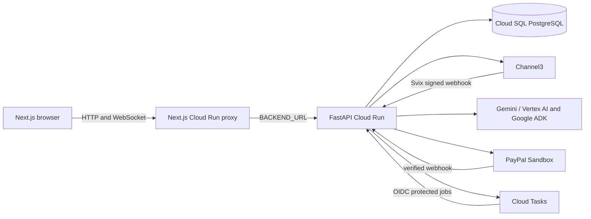

# ShopSide

**A little closer, even from afar.**

ShopSide is a collaborative shopping app. People share a room, discover products, compare options, discuss choices, and plan purchases together. Its Deal Rescue workflow connects participating fictional ShopSide merchants to buyer-approved negotiation limits. Real Channel3 listings remain retailer purchases; ShopSide does not claim their inventory or charge them through PayPal.

The app supports shared rooms for up to four participants, live chat and decisions, Channel3 product search, Smart Bundle, optional Move-in Studio visualization, Price Watch, a merchant portal, and PayPal Sandbox checkout for ShopSide-owned sample products. The sample merchant catalog is fictional: no goods ship and sandbox payments do not charge real money.

## Product and payment boundaries

| Product source | Discovery and comparison | Purchase path |
| --- | --- | --- |
| Channel3 live products | Real product records and retailer offers, with observed prices and availability | Open a fresh tracked retailer link and pay the retailer directly |
| ShopSide sandbox merchants | Fictional ShopSide-owned test catalog with tenant inventory and merchant policies | PayPal Sandbox CAPTURE checkout, or a short AUTHORIZE hold for an explicitly mapped merchant |

An external Channel3 price alert can create a request to find a ShopSide-owned alternative. The alternative may be a different item. The alert never authorizes payment for the external retailer product.

### Implemented workflows

- **Shared shopping:** private room membership, invitations, WebSocket updates, chat, reactions, shortlist, comparison, shared plans, and per-person approvals.
- **Channel3 discovery:** search, agentic search, structured price, brand, retailer, category, condition and color filters, product detail, variants, similar items, retailer offers, price history, image URL search, product URL lookup, affiliate attribution, and affiliate reporting when the Channel3 account permits it.
- **Smart Bundle:** ADK tools gather real Channel3 candidates; deterministic backend checks validate products, offers, categories, currency and budget. Bundles are observed-price suggestions, not compatibility guarantees or one-click retailer orders.
- **Move-in capabilities:** editable move-in mission and optional Three.js room. The 3D room uses markers and illustrative dressing; it does not verify product dimensions or fit. Ordinary shopping and shared rooms do not require WebGL.
- **Price Watch:** exact product and selected variant, retailer scope, threshold, pause/resume/cancel, shared subscription reuse, and price or availability alerts from signed Channel3 webhooks. Channel3 subscriptions operate in en-US/USD. Alerts may lag retailer changes.
- **Deal Rescue:** consented merchant matching, quantity, selected merchant, buyer maximum, negotiation preference, seller review requirement, bounded buyer-agent counteroffers, expiry, and revocation. Merchants can require human review.
- **PayPal Sandbox:** ordinary buyer-approved CAPTURE checkout remains available. For an explicitly mapped ShopSide merchant, the buyer can approve a capped AUTHORIZE hold before the seller responds. Settlement rechecks merchant, SKU, quantity, stock, buyer policy, currency, amount, expiry and PayPal readback. Lower capture is individually gated. Without verified lower-capture capability, ShopSide voids the hold and asks the buyer to approve a new checkout.
- **Receipts and webhooks:** completed owned-merchant orders have a receipt and decision timeline. PayPal and Channel3 webhooks require signature verification; processing jobs read provider state before changing payment or alert state.

## Architecture



The browser uses the frontend origin for API calls. The Next.js server forwards HTTP and WebSocket traffic to the backend URL configured at runtime. Provider credentials stay on the backend. FastAPI persists room state and payment records in PostgreSQL in production; SQLite is for local development. Cloud Tasks dispatch merchant and reconciliation jobs. Current room coordination and locks assume one API instance, so do not scale the backend horizontally until shared coordination is implemented.

## Local development

Prerequisites: Python 3.12, Node.js 24, npm, and optionally SQLite or PostgreSQL.

```bash
python3 -m venv .venv
.venv/bin/pip install -r services/api/requirements.lock
npm ci --prefix services/paypal-mcp
npm ci --prefix apps/web
cp .env.example .env
```

Configure optional local credentials in `.env` and load them into the shell. Treat `.env` as executable shell input; never commit it. Start the API:

```bash
export SHOPSIDE_DB="$PWD/shopside.sqlite3"
bash scripts/db/migrate.sh
PYTHONPATH=services/api .venv/bin/uvicorn app.main:app --host 127.0.0.1 --port 8000 --workers 1
```

In another terminal:

```bash
cd apps/web
BACKEND_URL=http://127.0.0.1:8000 npm run dev
```

Open `http://localhost:3000`, create a room and open its invitation in another browser profile. `bash scripts/dev.sh` is also available for local setup and startup. Without `DATABASE_URL`, the API uses `SHOPSIDE_DB` or `/tmp/shopside.sqlite3`.

Provider credentials are optional for local rooms and fictional catalog browsing. Live Channel3, AI, PayPal, webhook and Cloud Tasks features require their corresponding configuration. The three sandbox merchants start opted out and paused. Supply three distinct merchant tokens securely, then enable each merchant in `/merchant` for tests that need merchant responses.

## Configuration reference

Set secrets through a local secret store or GCP Secret Manager. Do not put secrets in browser variables, committed files, logs, or chat.

| Variable | Service | Purpose |
| --- | --- | --- |
| `BACKEND_URL` | Frontend | Backend HTTP(S) origin, no path or credentials. Set at runtime on Cloud Run. |
| `BACKEND_ID_TOKEN_AUDIENCE` | Frontend | Optional audience for an IAM-protected backend. Grant the frontend runtime identity `roles/run.invoker`. |
| `DATABASE_URL` | API | PostgreSQL connection. Required on Cloud Run; can use the Cloud SQL Unix socket format below. |
| `SHOPSIDE_DB` | API | Local SQLite database path when `DATABASE_URL` is absent. |
| `WEB_ORIGIN` | API | Exact public frontend origin, including scheme. |
| `COOKIE_SECURE` | API | Set `true` when the frontend is served over HTTPS. |
| `CHANNEL3_API_KEY` | API | Server-side Channel3 key. |
| `CHANNEL3_WEBHOOK_SECRET` | API | Svix signing secret from Channel3 webhook settings. |
| `PAYPAL_ENV` | API | Must be `sandbox` for the implemented checkout. |
| `PAYPAL_CLIENT_ID`, `PAYPAL_CLIENT_SECRET`, `PAYPAL_MERCHANT_ID` | API | PayPal Sandbox credentials and the payee used by standard checkout. |
| `PAYPAL_WEBHOOK_ID` | API | PayPal Sandbox webhook ID used to verify webhook signatures. |
| `PAYPAL_MERCHANT_IDS_JSON` | API | Optional JSON map from ShopSide merchant IDs to verified PayPal Sandbox payee IDs. Enables AUTHORIZE for mapped merchants. |
| `PAYPAL_PARTIAL_CAPTURE_MERCHANT_IDS_JSON` | API | Optional JSON array of merchant IDs whose lower-amount capture capability has been verified. Keep unset otherwise. |
| `AI_PROVIDER` | API | `vertex-express`, `vertex`, or `developer`. |
| `VERTEX_API_KEY` or `GEMINI_API_KEY` | API | Vertex AI express key, or Gemini Developer API key when selected. |
| `GEMINI_MODEL` | API | Model ID available to the selected provider. |
| `GOOGLE_CLOUD_PROJECT`, `GOOGLE_CLOUD_LOCATION` | API | Project and location for standard Vertex AI and Cloud Tasks. |
| `SHOPSIDE_MERCHANT_1_TOKEN` through `_3_TOKEN` | API | Distinct merchant portal tokens, at least 24 characters. Store as secrets. |
| `SHOPSIDE_MERCHANT_1_DOMAIN` through `_3_DOMAIN` | API | Optional merchant research labels; not proof of Channel3 inventory ownership. |
| `CLOUD_TASKS_LOCATION`, `CLOUD_TASKS_QUEUE`, `CLOUD_TASKS_TARGET_URL`, `CLOUD_TASKS_INVOKER_SERVICE_ACCOUNT` | API | Cloud Tasks queue, backend target and OIDC invoker. Set with `GOOGLE_CLOUD_PROJECT`; omit all for local fallback. |
| `CLOUD_TASKS_OIDC_AUDIENCE` | API | Optional audience override; defaults to the backend target URL. |
| `MERCHANT_JOB_TOKEN` | API | Local-only protected merchant-job recovery token. |

Cloud SQL Unix socket example:

```text
postgresql+psycopg://DB_USER:URL_ENCODED_PASSWORD@/DB_NAME?host=/cloudsql/PROJECT_ID:REGION:INSTANCE_ID
```

`PAYPAL_MERCHANT_IDS_JSON` and `PAYPAL_PARTIAL_CAPTURE_MERCHANT_IDS_JSON` are JSON configuration values, not PayPal secrets. Map only merchant accounts you have verified. A temporary authorization is not a long-term payment mandate. Vaulting and future off-session mandates are not implemented.

## Database migrations

Alembic revisions are in `services/api/alembic/versions`. Apply migrations once before starting the new revision:

```bash
bash scripts/db/migrate.sh
bash scripts/db/migrate.sh current
```

Revision `0005` adds durable Channel3 webhook events and watches, PayPal webhook payloads, and settlement jobs. Run migrations as a controlled deployment job, not concurrently from every application instance. The API retains startup table creation for its baseline tables.

The SQLite-to-PostgreSQL importer is `scripts/db/import_sqlite_to_postgres.py`. Use it only with a backup and an empty, migrated PostgreSQL destination; stop application traffic during import and verify the data before switching. It does not modify the SQLite source.

## GCP Cloud Run deployment

Use separate Cloud Run services for the frontend and API. Deploy the API first, apply the migration job, then deploy the frontend with `BACKEND_URL` set to the API origin. Keep the backend IAM protected when possible; Cloud Tasks uses OIDC identity to call protected worker endpoints.

1. Enable Cloud Run, Cloud SQL, Cloud Tasks and Secret Manager APIs. Create Cloud SQL PostgreSQL 17.11 and attach it to the backend service. Grant the backend runtime identity `roles/cloudsql.client` and access only to the secrets it needs.
2. Build and deploy the API from `services/api/Dockerfile` using the `services/` directory as build context. Set `DATABASE_URL`, `WEB_ORIGIN`, `COOKIE_SECURE=true`, provider settings, and the correct region/project variables.
3. Run `alembic -c /app/alembic.ini upgrade head` once in a Cloud Run Job using the API image, database attachment and runtime identity. Verify the job succeeds before routing traffic.
4. Create a Cloud Tasks queue and a dedicated task invoker service account. Grant the task account `roles/run.invoker` on the backend. Grant the backend producer identity permission to create tasks and `iam.serviceAccountUser` on the invoker identity. Set all Cloud Tasks variables on the backend.
5. Register `https://<backend-origin>/api/channel3/webhooks` in Channel3 and store the supplied Svix secret as `CHANNEL3_WEBHOOK_SECRET`. Register `https://<backend-origin>/api/paypal/webhook` in the PayPal Sandbox app and set `PAYPAL_WEBHOOK_ID`.
6. Deploy the frontend from `apps/web/Dockerfile`. Set `BACKEND_URL` at runtime to the backend origin. If the backend requires IAM, set `BACKEND_ID_TOKEN_AUDIENCE` to that service URL and grant the frontend identity `roles/run.invoker`.
7. Keep the API at one instance for this release. Current locking, room coordination and some job claims are process-local. Cloud SQL persistence does not make multiple API instances safe.
8. Configure Cloud Scheduler with OIDC to call `POST /api/internal/paypal-settlements/recover` for pending settlement jobs and `POST /api/internal/paypal-authorizations/expire` to void expired or revoked authorizations. The token email must match `CLOUD_TASKS_INVOKER_SERVICE_ACCOUNT`, because the backend verifies that exact identity; grant the Cloud Scheduler service agent permission to mint its OIDC token. Configure an appropriate timeout for WebSockets; browsers reconnect and reload the latest room state after disconnection.

Do not make a private backend public only to admit tasks. Match the task URL and audience to the deployed backend URL, and verify the task invoker identity. Cloud Run and Cloud Tasks IAM, Cloud SQL connectivity, provider webhook delivery, and PayPal buyer approval/capture must be checked in the target GCP project.

## Verification

Run locally:

```bash
PYTHONPATH=services/api .venv/bin/python -m pytest -q services/api/tests
npm run build --prefix apps/web
```

Browser tests are in `apps/web/tests` and run with Playwright against a locally running app. Use only disposable databases for tests; tests create rooms, payments and fictional inventory. The live discovery script `scripts/verify_live_discovery.py` calls Vertex AI and Channel3 and may consume quota. Review its behavior before running it with live credentials.

Automated tests do not prove a deployed Cloud Tasks delivery or interactive PayPal buyer authorization and capture. A PayPal order in `CREATED` status is not a completed payment. ShopSide marks payment complete only after provider readback verifies the capture.

## Current limitations

- Channel3 Price Watch subscriptions are limited to en-US/USD. Webhook alerts reflect when Channel3 detects an offer change, not an instant retailer update.
- PayPal is Sandbox only. The ordinary CAPTURE path and bounded AUTHORIZE workflow are implemented, but interactive buyer approval, capture and target-project webhook delivery still need to be verified in your GCP and PayPal Sandbox setup. Lower-amount capture stays disabled unless explicitly mapped as verified.
- No Channel3 programmatic checkout is enabled. External listings are purchased at their retailers, and ShopSide does not collect PayPal funds for them.
- No PayPal vaulting, long-lived payment mandate, or production off-session charging is implemented.
- Cloud Run multi-instance room coordination is not ready. Keep one backend instance until room locks, rate limits, payment claims and subscription lifecycle coordination use shared distributed primitives.
- Shipping and tax are zero for fictional ShopSide sandbox items. The app does not calculate delivered totals. Real retailer prices and stock can change.
- The 3D room uses illustrative markers, not product models or verified fit measurements. Smart Bundle compatibility and AI match scores are recommendations, not factual guarantees.
- Channel3 affiliate reporting depends on API-key entitlement and provider attribution data.

## Repository map

```text
apps/web/                         Next.js app, runtime proxy, browser tests
services/api/app/                 FastAPI room, discovery, agent, merchant and payment code
services/api/alembic/versions/    Versioned database migrations
services/api/tests/               Backend regression tests
services/paypal-mcp/              Pinned PayPal MCP dependency
scripts/db/                       Migration and SQLite import helpers
scripts/dev.sh                    Local development startup
scripts/verify_live_discovery.py  Opt-in live Vertex AI and Channel3 check
```

See [LICENSE](LICENSE) for the project license.
