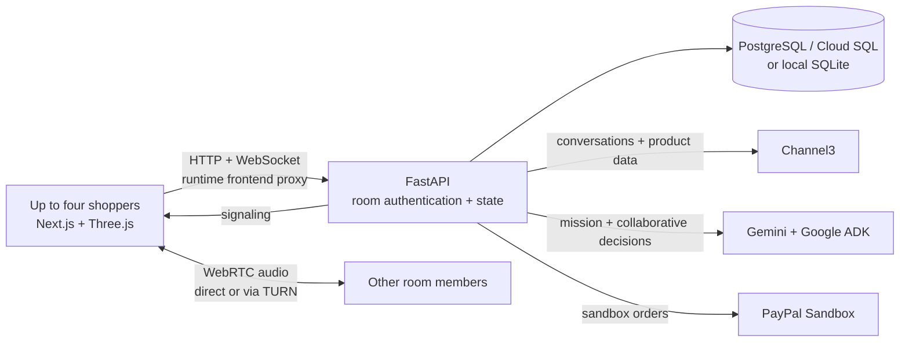

<div align="center">

# ShopSide

### Move in together, even when you're apart.

**A shared shopping space for life's next chapter.**

Plan a home, discover real products, and make the decision together.

`Next.js` · `FastAPI` · `Google ADK + Gemini` · `Channel3` · `Three.js` · `PayPal Sandbox` · `PostgreSQL`

[Get started](#get-started) · [How it works](#how-it-works) · [Configuration](#configuration) · [Cloud Run](#deploying-to-cloud-run) · [Testing](#testing)

</div>


## The idea

Setting up a new home involves more than finding a product. Families and friends have different priorities, a limited budget and a long list of decisions. ShopSide gives them one room to explore options, talk through tradeoffs and agree on what comes next.

Move-In Studio and general shopping share the same shared room for up to four people. Members join with a private invitation, see updates live and can reconnect to their saved state. A shared choice requires approval by every current member. No account is required for the guest flow.

| Experience | What it does |
| --- | --- |
| **Move-In Studio** | Turn a brief into an editable mission with budget, priorities and constraints; Gemini asks at most four follow-up questions. |
| **Real discovery** | Search Channel3 products, inspect available details and variants, compare retailer offers, and find similar or cheaper options when supported. |
| **Shared decisions** | Spotlight, shortlist, compare, chat, react and explicitly approve a choice. A reaction is not an approval. |
| **Live 3D room** | Place, move and react to shared product markers in an interactive Three.js room. |
| **Why this pick?** | Review known price and product facts, each person's feedback and details still worth checking. |
| **Voice** | Join an opt-in browser-to-browser WebRTC call with up to four room members, mute and leave controls. The four-person media path requires real-network verification. |
| **Checkout** | Visit the retailer for Channel3 products; use payer-approved PayPal Sandbox checkout for fictional ShopSide merchant items. |
| **Shared memory receipt** | An AI-written dual receipt is gated on timestamped approvals and two independently verified sandbox captures. Current checkout supports one payer, so it cannot yet create a dual receipt. |
| **Relocation desk** | Try an illustrative allowance, category policy and restricted purchase ledger; there is no HR or payroll integration. |

The interior artwork is AI-generated and illustrative. The 3D room uses generic set dressing and product **markers**, not actual product models or verified dimensions; it cannot prove a product will fit. If WebGL cannot start, a simplified interactive room is shown instead. Fictional ShopSide inventory does not ship goods.

## How it works



- The browser talks to its own frontend origin. The Node server proxies `/api/*` HTTP and WebSocket requests to the runtime `BACKEND_URL`; provider secrets stay on the backend.
- FastAPI stores room membership, mission, products, preferences, marker reactions, decisions and checkout status. Mutations use room membership, revision checks and command IDs; room snapshots are sent over WebSockets.
- **Channel3** is the primary source for real shopping conversations, search and product information. General shopping uses its native Conversations API; responses are buffered, not streamed.
- **Gemini** extracts the structured Move-In mission. The existing **Google ADK** agent helps with shared decisions using room context and tools. It cannot authorize payment or substitute an AI suggestion for human approval.
- **PayPal Orders v2** creates and captures eligible ShopSide sandbox orders. The official PayPal MCP adapter is restricted to reading the authenticated room's bound order; it does not authorize spending.
- External Channel3 offers keep their retailer URLs and are never charged through the ShopSide merchant account.

## Get started

### Prerequisites

- Python 3.12 and Node.js 24 with npm.
- SQLite for local development, or a PostgreSQL database. Cloud SQL PostgreSQL 17.11 is the intended GCP database.
- Provider credentials for the features you want to exercise. Rooms and the fictional catalog can run without live shopping, AI or PayPal credentials; provider-dependent actions report errors until configured.

### Local setup

From the repository root:

```bash
python3 -m venv .venv
.venv/bin/pip install -r services/api/requirements.lock
npm ci --prefix services/paypal-mcp
npm ci --prefix apps/web

# Optional: edit a local copy with your own settings. Never commit secrets.
cp .env.example .env
```

Load the desired variables from `.env` into your shell or set them through your environment manager. Then, in one terminal:

```bash
export SHOPSIDE_DB="$PWD/shopside.sqlite3"
bash scripts/db/migrate.sh
PYTHONPATH=services/api .venv/bin/uvicorn app.main:app --host 127.0.0.1 --port 8000 --workers 1
```

In a second terminal:

```bash
cd apps/web
BACKEND_URL=http://127.0.0.1:8000 npm run dev
```

Open **http://localhost:3000**. Create a room, copy the invite and open it in a separate browser profile with a different name. For a quick local startup, `bash scripts/dev.sh` installs dependencies, loads a local `.env` if present, applies migrations and starts both services. Only use an `.env` file you trust: the script sources it as shell input.

`SHOPSIDE_DB` is the SQLite file path; without it the API uses `/tmp/shopside.sqlite3`. `DATABASE_URL` takes precedence when set. Configure exactly **one API process and one worker** for the current MVP.

### Try the two-person journey

1. Choose **Move-In Studio** and enter: “We're moving next Friday and need a home office and kitchen under $500.” Review or edit the mission.
2. Choose **Find essentials with Channel3**. Focus a real result, inspect its details and retailer offers, and add it to the shared plan.
3. Invite a friend. Place a product marker in the 3D room, react to it, share preferences and discuss. Both people can explicitly approve a plan item.
4. Open a Channel3 offer at its retailer. For the fictional ShopSide merchant catalog, the designated payer can review a USD quote and approve a PayPal Sandbox order.

The 3D layout, reactions and decisions are shared. Cost shares record an allocation only: they do not charge either person or establish that both accepted the allocation.

## Configuration

Keep credentials on the server in secure environment settings or GCP Secret Manager. Do not place secrets in source control, browser code or chat. `.env.example` lists local settings; update `SHOPSIDE_DB` for your machine if using SQLite.

| Variable | Service | Purpose |
| --- | --- | --- |
| `BACKEND_URL` | Frontend | API HTTP(S) origin selected at server startup, such as `http://127.0.0.1:8000`; no path or credentials. |
| `BACKEND_ID_TOKEN_AUDIENCE` | Frontend | Optional API service URL for an IAM-protected Cloud Run backend. The frontend service account needs `roles/run.invoker`. |
| `DATABASE_URL` | API | PostgreSQL connection string. Required in Cloud Run; use Secret Manager. |
| `SHOPSIDE_DB` | API | Local SQLite path when `DATABASE_URL` is absent. |
| `WEB_ORIGIN` | API | Exact public frontend origin, including scheme and port when applicable. |
| `COOKIE_SECURE` | API | Set `true` when the public frontend uses HTTPS. |
| `CHANNEL3_API_KEY` | API | Server-side Channel3 API key. |
| `AI_PROVIDER` | API | `vertex-express`, `vertex` or `developer`; for this project use `vertex-express` if using a Vertex AI express key. |
| `VERTEX_API_KEY` or `GEMINI_API_KEY` | API | Vertex AI express key; `GEMINI_API_KEY` also supports the Developer API when that provider is selected. |
| `GEMINI_MODEL` | API | A tool-capable model ID available to the configured account. |
| `GOOGLE_CLOUD_PROJECT`, `GOOGLE_CLOUD_LOCATION` | API | Project and region for standard Vertex AI with Application Default Credentials; express mode does not need the project selector. |
| `PAYPAL_ENV` | API | Use `sandbox`; the implemented payment integration is sandbox-only. |
| `PAYPAL_CLIENT_ID`, `PAYPAL_CLIENT_SECRET`, `PAYPAL_MERCHANT_ID` | API | Credentials and merchant ID for the same PayPal sandbox business account. |
| `WEBRTC_ICE_SERVERS` | API | Optional JSON array of STUN/TURN server entries. Without it the application uses a public STUN server. |
| `RELOCATION_ADMIN_TOKEN` | API | Optional long, random bearer token for the illustrative relocation desk; it is disabled when unset. |

For example, a TURN provider supplies values in this shape:

```json
[{"urls":"stun:stun.l.google.com:19302"},{"urls":"turn:your-turn-host:3478","username":"YOUR_TURN_USERNAME","credential":"YOUR_TURN_CREDENTIAL"}]
```

Treat TURN credentials as secrets. STUN helps browsers find a route; TURN relays encrypted media when direct connections fail. ShopSide's WebSocket coordinates the connection; voice is not sent to Gemini. A TURN relay and a real two-network call are still needed for reliable cross-network verification.

The relocation token is separate from room membership. Allocation codes are reusable bearer capabilities and must be shared privately. The current shared-token desk is an illustration, not production employer identity or tenant isolation. Its ledger returns sandbox purchase summaries without private room chat or call data. The approval workflow is not connected; checkout blocks items requiring approval. The IAM-authenticated frontend proxy uses the `Authorization` header for its backend identity token, so the relocation desk's bearer-token authentication needs an alternate authentication design before those two modes can be used together.

## Database scripts

Alembic migrations are versioned under [`services/api/alembic/versions`](services/api/alembic/versions). They create rooms and payments, inventory, and relocation policies. Room-level features, including 3D markers and reactions, are stored in room state and do not require an additional migration.

| Command | Purpose |
| --- | --- |
| `bash scripts/db/migrate.sh` | Apply all pending migrations to the configured database. |
| `bash scripts/db/migrate.sh current` | Show the current Alembic revision. |
| `PYTHONPATH=services/api .venv/bin/python scripts/db/import_sqlite_to_postgres.py /path/to/source.sqlite3` | Copy a SQLite database into an **empty, migrated PostgreSQL database** selected by `DATABASE_URL`. |

The migration wrapper prefers `.venv/bin/alembic`, then an `alembic` on `PATH`; set `ALEMBIC_BIN` to use a different executable. The importer reads SQLite in a read-only transaction, copies rooms, members, payments, inventory and relocation policies, and refuses a nonempty destination. Older SQLite databases without a relocation-policy table are supported. It never deletes or modifies the source.

Before importing, **back up both databases and stop application traffic**. Apply migrations to a new empty PostgreSQL destination, run the importer before starting the API's inventory seeding, and verify the data before switching traffic. Never use a production database as a test target.

## Deploying to Cloud Run

1. Build the frontend using [`apps/web/Dockerfile`](apps/web/Dockerfile), and the API using [`services/api/Dockerfile`](services/api/Dockerfile) with `services/` as its build context. Both honor Cloud Run's `PORT`.
2. Attach Cloud SQL PostgreSQL 17.11 to the API service and give its service account `roles/cloudsql.client`. Inject `DATABASE_URL` from Secret Manager. For a Unix socket, the format is:

   ```text
   postgresql+psycopg://DB_USER:URL_ENCODED_PASSWORD@/DB_NAME?host=/cloudsql/PROJECT_ID:REGION:INSTANCE_ID
   ```

3. Run the migrations once as a controlled Cloud Run Job with the same image, database attachment and identity: `alembic -c /app/alembic.ini upgrade head`. Do not race migrations with app traffic. The API also creates missing baseline tables and seeds fictional inventory at startup for compatibility.
4. Set the frontend `BACKEND_URL` to the API origin. If the API is IAM-protected, set `BACKEND_ID_TOKEN_AUDIENCE` and grant the frontend service account `roles/run.invoker`. Runtime backend selection does not require a frontend rebuild.
5. Set `WEB_ORIGIN` to the exact HTTPS frontend origin and `COOKIE_SECURE=true` on the API. Configure the provider secrets and optional TURN or relocation settings described above.
6. Use **one API instance and one worker**, route to one revision and avoid overlapping revisions while testing. WebSocket subscribers, signaling, rate limits and operation locks are process-local. Cloud Run can temporarily exceed scaling limits; horizontal scaling needs shared coordination before it is safe. WebSocket timeouts can disconnect users, so use the existing reconnect control.

### Collaboration settings and troubleshooting

- Deploy the **API first**, then the frontend. The new API accepts existing membership cookies while the new frontend assigns a separate HttpOnly membership cookie to each tab. This avoids one browser window changing another person's identity. Refresh already-open tabs after the rollout.
- Set frontend `BACKEND_URL` to the backend Cloud Run **origin**. Open and share links from the same public frontend origin; don't send participants directly to the backend URL.
- Set backend `WEB_ORIGIN` to that exact frontend origin, such as `https://shop.example.com` (no trailing slash), and set `COOKIE_SECURE=true` for HTTPS. A mismatch can reject writes and WebSockets; missing cookies can prevent room membership.
- Point the backend at durable Cloud SQL via `DATABASE_URL`; local container files are ephemeral. Run one API worker and one active backend instance/revision for this MVP. The frontend reconnects automatically if a room socket drops, but process-local fanout and locks do not coordinate separate API instances. Raising the instance limit safely requires shared pub/sub and distributed concurrency controls, not just a shared database or Cloud Storage.
- Configure an appropriate Cloud Run request timeout for long-lived WebSockets. They can still disconnect, and the app reconnects and reloads the latest room snapshot. A second member should open the invitation, enter a different name and join; their existing chat history appears in the room.

Cloud SQL connectivity, the IAM-protected Cloud Run proxy, live cross-network audio and a complete PayPal buyer approval/capture have not been verified end to end in this workspace. This is a deployment guide, not a record that a deployment has occurred.

## Testing

```bash
# Backend: SQLite tests use an isolated temporary database.
PYTHONPATH=services/api .venv/bin/python -m pytest -q services/api/tests

# Frontend production build.
npm run build --prefix apps/web

# With the API and frontend running locally:
cd apps/web
SHOPSIDE_TEST_URL=http://localhost:3000 npx playwright test tests/invite-chat.spec.ts tests/room.spec.ts tests/move-in.spec.ts tests/room-preview.spec.ts tests/room-fallback.spec.ts tests/budget-consistency.spec.ts tests/family-room.spec.ts tests/family-voice-signaling.spec.ts --workers=1
```

Playwright expects Chromium; set `CHROMIUM_PATH` if it is not at `/usr/bin/chromium`. To run against a **disposable** PostgreSQL database, migrate it first and explicitly set `SHOPSIDE_TEST_DATABASE_URL`; the backend test fixture ignores an ambient `DATABASE_URL` to avoid touching a deployment database. The tests create room and payment records and reserve fictional inventory.

Live provider tests are opt-in and make real provider requests. With configured credentials, `PYTHONPATH=services/api .venv/bin/python scripts/verify_live_discovery.py` creates a verification room and calls Vertex AI and Channel3. Review the Playwright tests before enabling their live flags. Live tests can consume quota; never treat a mocked test as proof of provider checkout or audio.

## Status and limits

- Channel3 conversations, search, product detail, similar products, and default and agentic search were exercised against a configured account. Vertex AI express mission extraction and collaborative ADK calls were also exercised. Results and availability can change.
- A shared memory receipt requires two timestamped approvals and two independently verified sandbox payments. Existing checkout supports only one payer, so the receipt remains unavailable until a separately authorized two-payer checkout exists; prior approvals without timestamps are not backfilled.
- A real PayPal **sandbox order was created**, but buyer approval and capture have not been verified end to end. Never assume a completed purchase without provider read-back. Unknown payment outcomes require reconciliation before retrying.
- The existing backend and independent desktop/mobile browser tests cover room synchronization, four-member approval, marker placements and reactions, budget display, the no-WebGL fallback, cart boundaries and mocked payment behavior. Four-person voice signaling is tested with mocked WebRTC connections; real media and provider tests are separate.
- Product URL lookup, image search, price history, streaming assistant responses, affiliate reporting and product-alert webhooks are not implemented. The 3D preview is illustrative, not an accurate model or fit measurement.
- Relocation eligibility uses the known category and USD price of fictional merchant products. Administrator approvals, employer identity isolation and real HR integrations are not implemented.
- Room coordination and rate limits are in memory; PostgreSQL persistence alone does not enable multi-instance synchronization. Voice may require TURN; four-person audio and real cross-network calls have not been verified end to end.

## Project layout

```text
apps/web/                     Next.js UI, Three.js room and runtime API proxy
services/api/app/             FastAPI, room state, AI, discovery and checkout
services/api/alembic/         Versioned database migrations
services/paypal-mcp/          Pinned official PayPal MCP dependency
services/api/tests/           Backend regression tests
apps/web/tests/               Browser and runtime proxy tests
scripts/db/                   Migration and SQLite-to-PostgreSQL utilities
scripts/dev.sh                Local setup and startup
scripts/verify_live_discovery.py  Opt-in Vertex + Channel3 verification
```

Product imagery for the fictional catalog is illustrative. The headphones vector is original project artwork; the headphones rendering and Move-In interior are AI-generated illustrations and do not depict verified inventory. Real Channel3 images and offers are attributed to their providers and retailers.

## License

See [LICENSE](LICENSE).
